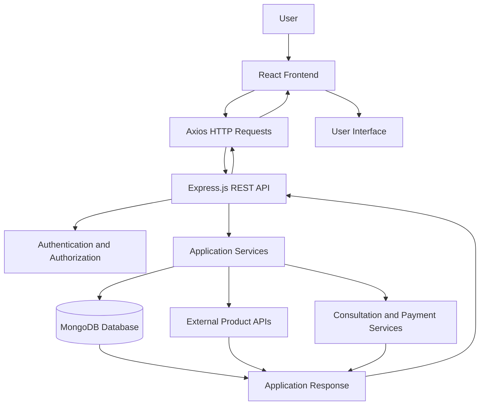

# 🌸 SkinBloom — Your Personal Skincare Companion

<div align="center">

**Track Your Skincare. Discover Products. Connect with Professionals.**

A full-stack skincare management platform designed to help users organize their skincare routines, explore beauty products, monitor prices, and access professional skincare consultations.

[](https://react.dev/)
[](https://nodejs.org/)
[](https://expressjs.com/)
[](https://www.mongodb.com/)
[](https://developer.mozilla.org/en-US/docs/Web/JavaScript)

[**View Repository**](https://github.com/Tuhfa2512/SkinBloom)

</div>

---

## 📌 Overview

Taking care of your skin involves more than choosing products. It requires consistency, understanding your skincare needs, organizing routines, and finding suitable products.

**SkinBloom** is a full-stack web application built with the MERN stack (MongoDB, Express.js, React, and Node.js) to bring essential skincare management features into one platform.

The application combines skincare routine management with beauty product discovery, wishlist management, price monitoring, product comparisons, and professional dermatologist consultation functionality.

SkinBloom aims to provide a convenient and organized digital experience for users who want to manage their skincare journey.

## 🎯 Project Objectives

- Simplify personal skincare routine management.
- Provide a centralized platform for discovering skincare and beauty products.
- Allow users to save favorite products and monitor prices.
- Help users compare products before making purchasing decisions.
- Support professional skincare consultations.
- Provide administrative tools for managing products and product categories.
- Deliver a convenient and user-friendly skincare experience.

---

## ✨ Key Features

### 🧴 Skincare Management
- Organize and track personal skincare routines.
- Access a centralized skincare management experience.
- Keep skincare-related activities organized.

### 🛍️ Beauty Product Discovery
- Browse skincare and beauty products.
- Explore product information, brands, categories, ingredients, and prices.
- Integrate external product data sources where configured.

### ❤️ Wishlist Management
- Save favorite products for future reference.
- Add or remove products from a personal wishlist.
- Configure price alerts for selected products.

### 📊 Product Comparison
- Compare multiple products side by side.
- Review product information to support purchasing decisions.
- Create and share product comparisons.

### 📈 Price Tracking
- Monitor saved products and their price history.
- Configure target prices.
- Manage price-tracking alerts and refresh tracked prices.

### 👩‍⚕️ Dermatologist Consultations
- Support a professional consultation workflow.
- Provide dedicated functionality for dermatologist-related interactions.
- Support role-based access for relevant application users.

### 🔐 Authentication and Role-Based Access
- Provide user authentication.
- Support different application roles, including users, administrators, and dermatologists.
- Protect role-specific functionality.

### ⚙️ Administrative Dashboard
- Manage product information.
- Manage product categories.
- Access category statistics and product management functionality.

---

## 🏗️ System Architecture

SkinBloom follows a client-server architecture using the MERN stack.



### Architecture Components

| Component | Responsibility |
|---|---|
| React | Builds the interactive frontend interface |
| React Router | Handles frontend navigation |
| Axios | Communicates with backend APIs |
| Node.js | Runs the backend JavaScript environment |
| Express.js | Handles API routes and server requests |
| MongoDB | Stores application data |
| Mongoose | Models and manages MongoDB documents |
| JWT | Supports authentication workflows |
| External APIs | Provide additional product data where configured |
| Stripe | Supports payment-related functionality where configured |

---

## 🛠️ Technology Stack

| Category | Technologies |
|---|---|
| Frontend | React 18, React Router |
| Styling | Tailwind CSS, PostCSS |
| Backend | Node.js, Express.js |
| Database | MongoDB, Mongoose |
| Authentication | JSON Web Tokens, bcryptjs |
| HTTP Client | Axios |
| Image Processing | Sharp |
| File Uploads | Multer |
| PDF Generation | PDFKit, jsPDF |
| External Integrations | Product APIs, ImageKit |
| Payment Integration | Stripe |
| Development Tools | Vite, Nodemon |

---

## 📂 Repository Structure

```text
SkinBloom/
│
├── client/
│   ├── public/
│   ├── src/
│   ├── package.json
│   └── vite.config.js
│
├── server/
│   ├── server.js
│   ├── package.json
│   ├── createAdmin.js
│   ├── models/
│   ├── routes/
│   └── middleware/
│
├── AUTHENTICATION_TEST_GUIDE.md
├── DEPLOYMENT_SUMMARY.md
├── DERMATOLOGIST_CONSULTATION_SYSTEM.md
├── DERMATOLOGIST_SYSTEM_COMPLETE.md
├── ECOMMERCE_TESTING_GUIDE.md
├── IMPLEMENTATION_GUIDE.md
├── ROLE_BASED_AUTH_GUIDE.md
├── UPLOAD_DEBUG_GUIDE.md
├── UPLOAD_FIXED.md
├── UPLOAD_TEST_GUIDE.md
├── products_60.csv
└── README.md
```

*Note: This is a high-level overview. The exact folders and files inside `client/src` and `server` may differ from this illustrative tree.*

---

## 🚀 Getting Started

Follow these instructions to run SkinBloom locally.

### Prerequisites

Make sure you have installed:

- [Node.js](https://nodejs.org/) and npm
- [MongoDB](https://www.mongodb.com/try/download/community) or a MongoDB Atlas database
- [Git](https://git-scm.com/)
- A code editor such as Visual Studio Code

### 1. Clone the Repository

```bash
git clone https://github.com/Tuhfa2512/SkinBloom.git
cd SkinBloom
```

### 2. Configure the Backend

Navigate to the server directory:

```bash
cd server
npm install
```

Create a `.env` file inside the `server` directory.

Example configuration:

```env
PORT=5000
MONGO_URI=your_mongodb_connection_string
JWT_SECRET=your_secure_jwt_secret
FRONTEND_URL=http://localhost:5173
```

Add any additional API credentials required by the features you intend to use.

**Security:** Replace the example values with your own credentials. Never commit real secrets or database connection strings to GitHub.

Start the backend:

```bash
npm run dev
```

The backend is expected to run at `http://localhost:5000` when configured with the example port.

### 3. Configure the Frontend

Open a second terminal and navigate to the project directory:

```bash
cd SkinBloom/client
npm install
npm run dev
```

Vite will display the local frontend URL in your terminal. With the default configuration, it is typically:

```text
http://localhost:5173
```

### 4. Open SkinBloom

Open the frontend URL in your browser. Ensure the backend is running and the MongoDB connection is configured correctly.

If a feature depends on an external API, configure its required credentials before testing that feature.

---

## 🔑 Environment Variables

The backend implementation guide documents the following configuration variables.

| Variable | Purpose |
|---|---|
| `PORT` | Backend server port |
| `MONGO_URI` | MongoDB connection string |
| `JWT_SECRET` | Secret used for JWT-related authentication |
| `FRONTEND_URL` | Frontend origin used by the backend |
| `RAPIDAPI_KEY` | Optional external API access |
| `SEPHORA_API_KEY` | Optional Sephora integration credential |
| `ULTA_API_KEY` | Optional Ulta integration credential |

Use the actual environment-variable names expected by the relevant integration. Additional credentials may be needed for payment processing, image hosting, or other external services.

Keep all secret values in local environment files or secure deployment settings, not in the repository.

---

## 🧪 Running the Application

### Start the Backend

```bash
cd server
npm run dev
```

The server package also defines a production-style start command:

```bash
npm start
```

### Start the Frontend

In a separate terminal:

```bash
cd client
npm run dev
```

### Build the Frontend

To generate a production build:

```bash
cd client
npm run build
```

To preview the production build locally:

```bash
npm run preview
```

---

## 🧭 Application Workflow

1. **Access the application:** Open SkinBloom through the frontend.
2. **Authenticate:** Sign in through the configured authentication workflow.
3. **Explore products:** Browse available skincare and beauty products.
4. **Save favorites:** Add products to your wishlist.
5. **Compare products:** Select products and review their details side by side.
6. **Track prices:** Configure target prices and manage available price alerts.
7. **Access professional features:** Use the consultation workflow where configured.
8. **Manage the platform:** Authorized administrators can access relevant management features.

---

## 🔒 Security Considerations

- Store credentials in environment variables.
- Do not expose JWT secrets or database credentials.
- Restrict administrative and dermatologist functionality to authorized roles.
- Validate incoming API requests.
- Configure production CORS settings appropriately.
- Use HTTPS in production.
- Keep dependencies updated and review authentication and file-upload security.

---

## 🔮 Future Improvements

Potential enhancements for SkinBloom include:

- More personalized skincare recommendations.
- Improved skincare routine reminders and progress tracking.
- More robust product reviews and ratings.
- Enhanced product search and filtering.
- Notifications for price changes.
- Additional external product integrations.
- Further usability and accessibility improvements.

These are potential improvements, not a claim that all of these features are currently implemented.

---

## 📚 Project Documentation

The repository contains additional documentation for specific implementation areas:

- [Implementation Guide](./IMPLEMENTATION_GUIDE.md)
- [Authentication Test Guide](./AUTHENTICATION_TEST_GUIDE.md)
- [Role-Based Authentication Guide](./ROLE_BASED_AUTH_GUIDE.md)
- [Dermatologist Consultation System](./DERMATOLOGIST_CONSULTATION_SYSTEM.md)
- [E-commerce Testing Guide](./ECOMMERCE_TESTING_GUIDE.md)
- [Deployment Summary](./DEPLOYMENT_SUMMARY.md)

---

## 👩‍💻 Author

**Tasneem Tuhfa**

Computer Science and Engineering

[GitHub Profile](https://github.com/Tuhfa2512)

---

## 📄 License

No license has been specified in this README. Check the repository for a `LICENSE` file and add the applicable license information before distributing or reusing the project.

---

<div align="center">

**SkinBloom — Grow Your Skincare Journey 🌸**

*Discover. Organize. Compare. Care.*

</div>
