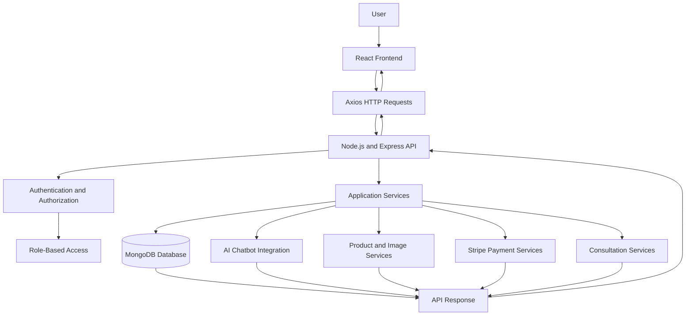

# 🌸 SkinBloom — Your Personal Skincare Companion

<div align="center">

**Track Your Skincare. Discover Products. Chat with AI. Connect with Professionals.**

An AI-enhanced, full-stack skincare management and e-commerce platform built with the MERN stack.

SkinBloom brings together personalized skincare routine management, beauty product discovery, online shopping, an AI-powered skincare chatbot, price tracking, and professional dermatologist consultations.

[](https://react.dev/)
[](https://nodejs.org/)
[](https://expressjs.com/)
[](https://www.mongodb.com/)
[](https://developer.mozilla.org/en-US/docs/Web/JavaScript)
[](https://vite.dev/)

### 🌐 Live Application

**[Visit SkinBloom](https://skin-bloom.vercel.app/)**

**[Backend API](https://skinbloom-api.onrender.com/)**

**[GitHub Repository](https://github.com/Tuhfa2512/SkinBloom)**

</div>

---

## 📌 Overview

Taking care of your skin involves more than selecting beauty products. It requires consistency, understanding individual skincare needs, following appropriate routines, and accessing reliable information.

**SkinBloom** is a full-stack skincare management platform developed using the MERN stack: MongoDB, Express.js, React.js, and Node.js.

The platform integrates skincare routine tracking, an e-commerce system, AI-powered skincare assistance, dermatologist consultations, product comparison, wishlist management, and price monitoring into a centralized web application.

SkinBloom aims to make skincare management more organized, accessible, interactive, and convenient.

---

## 🎯 Project Objectives

- Simplify personal skincare routine management.
- Provide a centralized platform for skincare and beauty products.
- Integrate an AI-powered chatbot for interactive skincare assistance.
- Allow users to browse, search, compare, and purchase products.
- Support shopping cart and wishlist management.
- Enable product price tracking and alerts.
- Facilitate professional dermatologist consultations.
- Implement secure authentication and role-based authorization.
- Provide administrative tools for managing products and categories.
- Deliver a responsive and user-friendly experience.

---

## ✨ Key Features

### 🤖 AI-Powered Skincare Chatbot

SkinBloom includes an AI-powered skincare chatbot designed to provide interactive assistance with skincare-related questions.

**Features:**

- Conversational interface for skincare-related queries.
- AI-assisted responses to user questions.
- Support for general skincare routine and product-related information.
- Integration with the application's frontend and backend.
- Convenient access to skincare guidance within the platform.

The chatbot enhances the user experience by making skincare information more accessible through natural-language interaction.

> **Disclaimer:** AI-generated skincare information is intended for general educational purposes and should not replace professional medical advice, diagnosis, or treatment.

### 🧴 Skincare Routine Management

- Create and manage personal skincare routines.
- Organize skincare-related activities.
- Track routine progress and consistency.
- Access dedicated skincare routine pages.
- Support routine reminders and tracking workflows.

### 🛍️ Beauty Product Discovery

- Browse skincare and beauty products.
- View detailed product descriptions.
- Explore brands, categories, ingredients, prices, and product information.
- Search and filter products.
- Explore products based on available categories and attributes.
- Support product data imports and external product integrations where configured.

### 🛒 E-Commerce and Shopping Cart

SkinBloom includes an integrated shopping experience.

- Add products to the shopping cart.
- Update product quantities.
- Remove products from the cart.
- View cart details and totals.
- Access checkout and payment workflows.
- Support product orders and payment verification.
- Generate PDF payment receipts.

### ❤️ Wishlist Management

- Save favorite skincare products.
- Add or remove products from a personal wishlist.
- Revisit products for future purchases.
- Configure price alerts for selected products.

### 📊 Product Comparison

- Compare skincare products side by side.
- Review product details, ingredients, and pricing.
- Evaluate products before purchasing.
- Support shareable product comparisons.

### 📈 Price Tracking and Alerts

- Monitor product price information.
- Maintain price history where available.
- Configure target prices.
- Manage price-tracking alerts.
- Refresh tracked product prices through configured integrations.

### 👩‍⚕️ Dermatologist Consultation System

SkinBloom includes a dedicated dermatologist consultation workflow.

- Access dermatologist-related features.
- Request professional skincare consultations.
- Manage consultation bookings.
- Support booking and payment verification workflows.
- Provide role-specific dermatologist functionality.
- Generate consultation payment receipts.

### 🔐 Authentication and Role-Based Authorization

SkinBloom supports multiple user roles:

- **User:** Access skincare routines, products, shopping features, and consultations.
- **Dermatologist:** Access dermatologist-specific dashboard and consultation functionality.
- **Administrator:** Access administrative management features.

Authentication and authorization features include:

- User registration and login.
- JWT-based authentication.
- Password hashing.
- Protected frontend routes.
- Role-based access restrictions.
- Automatic redirects according to user roles.

### ⚙️ Administrative Dashboard

- Manage product information.
- Manage product categories.
- Access category statistics.
- Support product inventory and management workflows.
- Access administrator-specific features.

### 🎨 Responsive User Interface

- React-based interactive interface.
- Responsive layouts for different screen sizes.
- Product cards and detailed product pages.
- Interactive navigation.
- User-focused dashboards.
- Modern styling and visual components.

---

## 🏗️ System Architecture

SkinBloom follows a client-server architecture using the MERN stack.



### Architecture Components

| Component | Responsibility |
|---|---|
| React | Builds the frontend interface |
| React Router | Handles navigation and protected routes |
| Axios | Communicates with backend APIs |
| Node.js | Runs the backend application |
| Express.js | Provides REST API endpoints |
| MongoDB | Stores application data |
| Mongoose | Manages MongoDB models and queries |
| JWT | Supports authentication |
| AI Chatbot | Provides conversational skincare assistance |
| Stripe | Supports payment processing |
| Sharp | Processes images |
| Multer | Handles file uploads |
| ImageKit | Supports image-related integrations |
| jsPDF | Generates client-side PDF receipts |

---

## 🛠️ Technology Stack

| Category | Technologies |
|---|---|
| Frontend | React 18, React Router |
| Frontend Build Tool | Vite |
| Styling | CSS, Tailwind CSS, PostCSS |
| Backend | Node.js, Express.js |
| Database | MongoDB, Mongoose |
| Authentication | JWT, bcryptjs |
| HTTP Client | Axios |
| AI Integration | AI-powered chatbot integrated with the application |
| Payments | Stripe |
| Image Processing | Sharp |
| File Uploads | Multer |
| Image Integration | ImageKit |
| PDF Generation | jsPDF, PDFKit |
| Development Tools | Git, GitHub, VS Code, GitHub Codespaces, Nodemon |
| Frontend Hosting | Vercel |
| Backend Hosting | Render |

### Recent Dependency Updates

The following frontend dependencies were updated during the latest security maintenance:

| Dependency | Updated Version |
|---|---|
| React | 18.3.1 |
| React DOM | 18.3.1 |
| React Router DOM | 7.18.4 |
| jsPDF | 4.2.1 |
| Vite | 5.4.21 |

These versions reflect the latest locally verified development environment. They may differ from the currently deployed version until the dependency changes are committed and deployed.

---

## 📂 Repository Structure

```text
SkinBloom/
│
├── client/
│   ├── public/
│   ├── src/
│   │   ├── components/
│   │   ├── context/
│   │   ├── ui/
│   │   ├── main.jsx
│   │   └── styles.css
│   ├── package.json
│   ├── package-lock.json
│   └── vite.config.js
│
├── server/
│   ├── server.js
│   ├── models/
│   ├── routes/
│   ├── middleware/
│   ├── package.json
│   └── package-lock.json
│
├── AUTHENTICATION_TEST_GUIDE.md
├── DEPLOYMENT_SUMMARY.md
├── DERMATOLOGIST_CONSULTATION_SYSTEM.md
├── DERMATOLOGIST_SYSTEM_COMPLETE.md
├── ECOMMERCE_TESTING_GUIDE.md
├── IMPLEMENTATION_GUIDE.md
├── ROLE_BASED_AUTH_GUIDE.md
├── UPLOAD_DEBUG_GUIDE.md
├── UPLOAD_FIXED.md
├── UPLOAD_TEST_GUIDE.md
└── README.md
```

*Note: This is a high-level representation of the repository. Additional scripts, product datasets, image-processing utilities, and application files may be present.*

---

## 🚀 Getting Started

Follow these instructions to run SkinBloom locally.

### Prerequisites

Install the following:

- [Node.js](https://nodejs.org/) and npm
- [MongoDB](https://www.mongodb.com/) or MongoDB Atlas
- [Git](https://git-scm.com/)
- Visual Studio Code or another code editor

### 1. Clone the Repository

```bash
git clone https://github.com/Tuhfa2512/SkinBloom.git
cd SkinBloom
```

### 2. Configure the Backend

```bash
cd server
npm install
```

Create a `.env` file inside the `server` directory.

Example:

```env
PORT=5000
MONGO_URI=your_mongodb_connection_string
JWT_SECRET=your_secure_jwt_secret
FRONTEND_URL=http://localhost:5173
```

Additional environment variables may be required for:

- Stripe payments
- AI chatbot services
- ImageKit
- External product APIs
- Other configured integrations

Use the exact variable names expected by the relevant application code.

**Never commit real API keys, database credentials, access tokens, or secrets to GitHub.**

Start the backend:

```bash
npm run dev
```

With the example configuration, the backend runs at:

```text
http://localhost:5000
```

### 3. Configure the Frontend

Open another terminal from the repository root:

```bash
cd client
npm install
```

If your frontend needs an API URL, configure it in `client/.env`:

```env
VITE_API_URL=http://localhost:5000/api
```

Start the frontend:

```bash
npm run dev
```

The frontend typically runs at:

```text
http://localhost:5173
```

### 4. Access the Application

Open the frontend URL in your browser.

Ensure that:

- The backend is running.
- MongoDB is connected.
- Required environment variables are configured.
- External services are available for the features being tested.

---

## 🌐 Deployment

SkinBloom uses separate frontend and backend deployments.

### Frontend — Vercel

**Live URL:** https://skin-bloom.vercel.app/

The React frontend is deployed using Vercel.

### Backend — Render

**Backend URL:** https://skinbloom-api.onrender.com/

The Node.js and Express backend is hosted on Render.

### Deployment Configuration

For production deployments:

- Configure the correct frontend and backend URLs.
- Set environment variables in the hosting platform.
- Configure the backend CORS allowlist.
- Use HTTPS for API communication.
- Keep secrets in the deployment environment rather than source code.
- Verify authentication and payment functionality after deployment.

**Deployment note:** Recent frontend dependency updates were verified locally. They should not be considered deployed until committed, pushed, and successfully built by Vercel.

---

## 💳 Payment Integration

SkinBloom includes Stripe-based payment workflows for product purchases and consultation bookings.

Payment-related functionality includes:

- Checkout integration.
- Payment verification endpoints.
- Product order confirmation.
- Consultation payment confirmation.
- PDF receipt generation using jsPDF.

Payment processing requires valid Stripe configuration.

Production payment flows should be tested independently before accepting real transactions.

---

## 🤖 AI Chatbot Integration

The AI-powered skincare chatbot is integrated into SkinBloom's application workflow.

### Purpose

The chatbot is designed to help users interactively explore skincare-related information.

### Application Integration

The chatbot works alongside SkinBloom's existing frontend and backend architecture.

Its implementation includes chatbot-related backend routing and an interactive application experience.

### Responsible Use

AI chatbot responses are informational and may contain inaccuracies. Users should consult qualified healthcare professionals for medical concerns.

---

## 🧪 Testing and Build Verification

### Frontend Development

```bash
cd client
npm run dev
```

### Frontend Production Build

```bash
cd client
npm run build
```

### Preview Production Build

```bash
npm run preview
```

### Backend Development

```bash
cd server
npm run dev
```

### Backend Start

```bash
npm start
```

### Latest Build Verification

The frontend production build was successfully completed after updating jsPDF and React Router.

**Latest observed build:**

- Vite version: 5.4.21
- Modules transformed: 513
- Build completed successfully
- Build duration: approximately 5.51 seconds

The build reported non-blocking warnings concerning CSS syntax and large JavaScript bundles.

A successful build confirms compilation, but does not guarantee that all application features have passed browser or integration testing.

---

## 🔒 Security and Dependency Maintenance

SkinBloom has undergone dependency security maintenance for both the frontend and backend.

### Completed Security Work

- Updated frontend dependencies to address reported vulnerabilities.
- Updated jsPDF to version 4.2.1.
- Updated React Router DOM to version 7.18.4.
- Updated backend dependencies, including Sharp.
- Enabled GitHub Dependabot.
- Enabled GitHub secret scanning and protection features.
- Removed an exposed test credential file from the current tracked repository tree.
- Reviewed production dependency audit reports.

### Latest Frontend Production Audit

The latest locally executed command:

```bash
cd client
npm audit --omit=dev
```

Reported:

| Severity | Findings |
|---|---:|
| Critical | 0 |
| High | 0 |
| Moderate | 0 |
| Low | 0 |

**Total: 0 reported vulnerabilities in frontend production dependencies at the time of testing.**

### Backend Production Audit

The previously verified backend production audit reported:

| Severity | Findings |
|---|---:|
| Critical | 0 |
| High | 0 |
| Moderate | 2 |

### Remaining Security Work

- Review remaining backend Moderate findings.
- Review frontend development dependency findings.
- Recheck GitHub Dependabot alerts.
- Verify deployment of the latest frontend dependency updates.
- Continue reviewing authentication, authorization, uploads, and API security.

**Important:** An npm audit with zero findings does not guarantee that an application is free from all security vulnerabilities.

Previously exposed credentials should be rotated, and repository history should be reviewed when necessary.

---

## 🧭 Application Workflow

1. **Visit SkinBloom:** Open the deployed application.
2. **Register or log in:** Access the application through its authentication workflow.
3. **Explore skincare products:** Browse and search available products.
4. **Chat with AI:** Ask skincare-related questions through the chatbot.
5. **Manage skincare routines:** Organize and track skincare activities.
6. **Save favorites:** Add products to the wishlist.
7. **Compare products:** Review product details side by side.
8. **Track prices:** Configure price alerts and monitor product information.
9. **Shop online:** Add products to the cart and proceed to checkout.
10. **Consult dermatologists:** Access consultation booking functionality.
11. **Manage the platform:** Authorized administrators and dermatologists can access role-specific dashboards.

---


## 📋 Current Development Status

| Feature or Area | Status |
|---|---|
| MERN application architecture | ✅ Implemented |
| Product browsing and details | ✅ Implemented & Tested |
| Shopping cart and wishlist | ✅ Implemented & Tested |
| Skincare routine management | ✅ Implemented & Tested |
| AI skincare chatbot | ✅ Implemented & Tested |
| User registration and login | ✅ Implemented & Tested |
| Role-based authentication | ✅ Implemented & Tested |
| Admin and dermatologist dashboards | ✅ Implemented & Tested |
| Dermatologist consultation workflow | ✅ Implemented & Tested |
| Stripe payment integration | ✅ Implemented & Tested |
| PDF receipt generation | ✅ Implemented & Tested |
| Vercel frontend deployment | ✅ Deployed |
| Render backend deployment | ✅ Deployed |
| Frontend production dependency security audit | ✅ 0 reported vulnerabilities |
| Frontend production build | ✅ Successful |
| Backend dependency security improvements | ✅ Critical and High findings addressed |

> **Note:** Core features have been implemented and previously tested. Recent dependency upgrades were successfully built locally; regression testing and deployment of those latest updates may still be required.


---

## 🔮 Future Improvements

Potential future enhancements include:

- More personalized AI-assisted skincare recommendations.
- Improved chatbot response quality and safety.
- Enhanced skincare routine reminders.
- More advanced progress tracking.
- Product recommendation improvements.
- Better product search and filtering.
- Enhanced notification systems.
- Additional external product integrations.
- Accessibility and usability improvements.
- Improved frontend performance through code splitting.
- Expanded automated testing.
- Continued security monitoring and dependency updates.

These are planned or potential improvements and are not claims of completed functionality.

---

## 📚 Project Documentation

Additional repository documentation includes:

- [Implementation Guide](./IMPLEMENTATION_GUIDE.md)
- [Authentication Test Guide](./AUTHENTICATION_TEST_GUIDE.md)
- [Role-Based Authentication Guide](./ROLE_BASED_AUTH_GUIDE.md)
- [Dermatologist Consultation System](./DERMATOLOGIST_CONSULTATION_SYSTEM.md)
- [E-commerce Testing Guide](./ECOMMERCE_TESTING_GUIDE.md)
- [Deployment Summary](./DEPLOYMENT_SUMMARY.md)
- [Upload Test Guide](./UPLOAD_TEST_GUIDE.md)

---

## 👩‍💻 Author

**Tasneem Tuhfa**

Computer Science and Engineering

[GitHub Profile](https://github.com/Tuhfa2512)

[SkinBloom Repository](https://github.com/Tuhfa2512/SkinBloom)

---

## 📄 License

Check the repository for an applicable `LICENSE` file before reusing or redistributing the project.

---

<div align="center">

### 🌸 SkinBloom — Grow Your Skincare Journey

**Discover. Organize. Compare. Chat. Care.**

Built with the MERN stack and AI-assisted skincare functionality.

</div>
